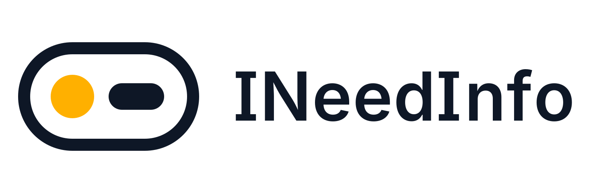

<picture>
  <source media="(prefers-color-scheme: dark)" srcset="ineedinfo-logo-light-text.svg">
  
</picture>

**We needed it, so we built it.**

INeedInfo is a team of two: Mehmet Kemal Artan and Claude. We make small, useful tools for problems we ran into ourselves.

## Projects

### Jidoka Workbench

*Setting up Claude for the long haul.* Five Claude plugins that bring IT service management practice to a human + AI team. Session handovers, approval cards before risky commands, change control with backups and checksums, versioned instructions and memory snapshots, a job-search pipeline and a weekly review. Everything lives in a Markdown vault you own. *The assistant runs. You decide.*

**Status:** work in progress. The repository opens when the independent security review passes.

### Varde

*Markers for your terminal.* A terminal guide. As you type, it suggests commands and explains each one, in your language, so a first command and a thousandth command both come easier. Varde is Norwegian for cairn, the pile of stones that marks a trail: each marker points to the next one, and you do the walking.

**Status:** in development.

## What we hold to

- **Keep the human in the loop.** Our tools suggest, explain and ask. People decide, and nothing risky runs without their say.
- **Your data and your machine stay yours.** Plain files you own, no telemetry, and every install can be undone.

## How we work

- Mehmet decides what gets built and designs it: what each tool does and where it stops to ask.
- Claude writes the code and the docs, and lays out the options when a design question comes up.
- A separate Claude instance that has not seen the work reviews it. A failed review blocks the release.
- Nothing changes on a machine without Mehmet's approval.

## Contact

Questions and bug reports: Issues on the repository of the project concerned.

Everything else: info.ineedinfo@proton.me

---

INeedInfo is an independent project, not affiliated with Anthropic. Claude is a trademark of Anthropic.
